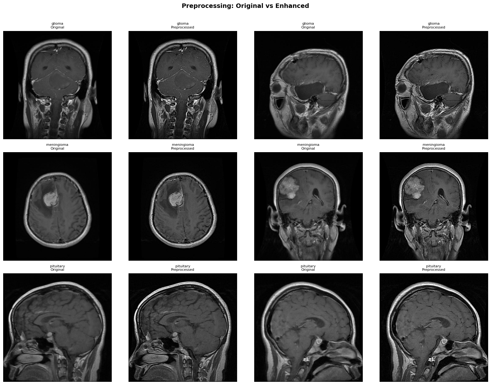
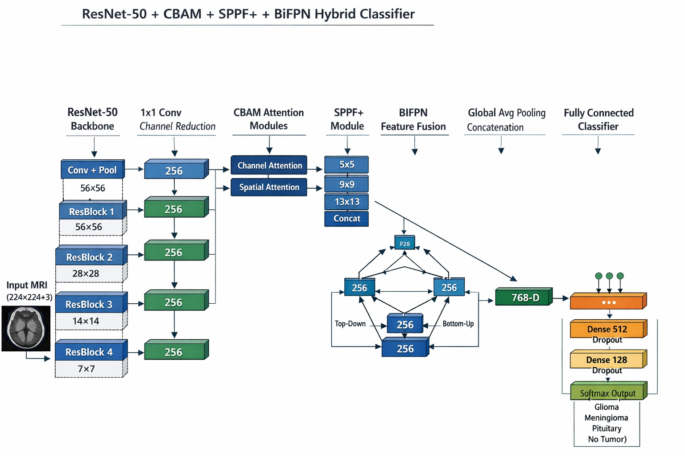
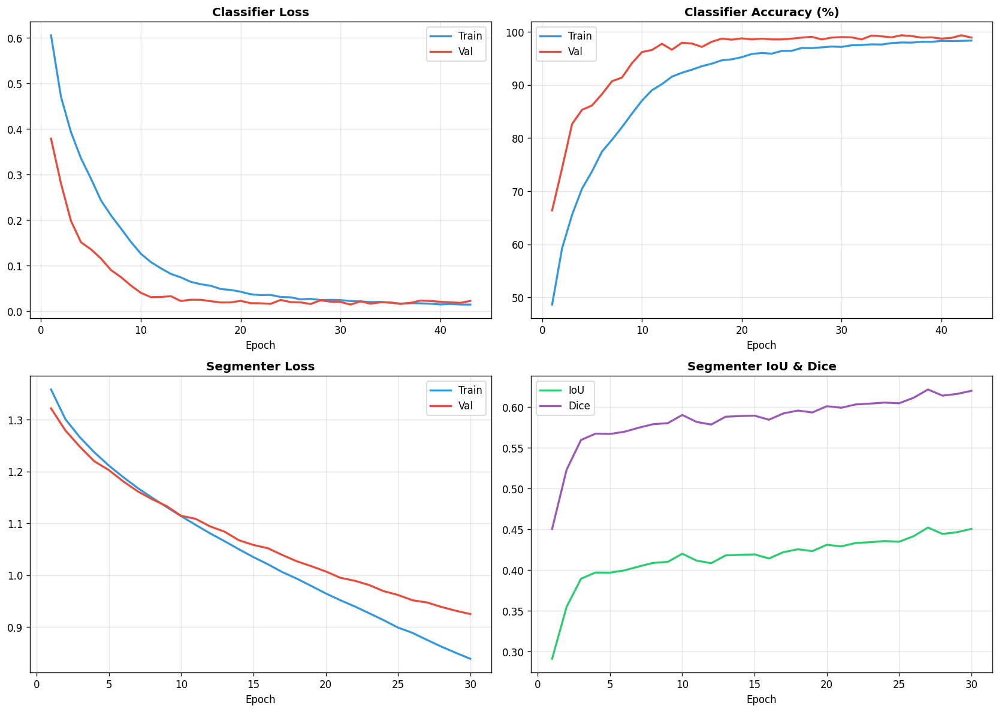
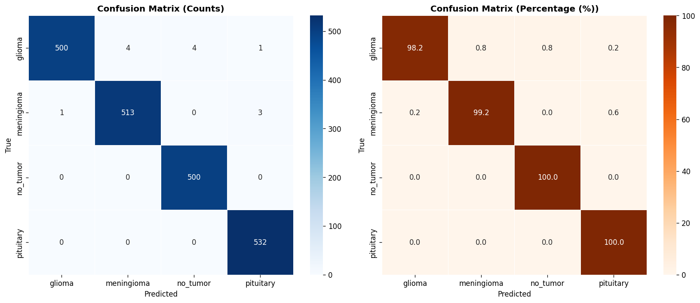
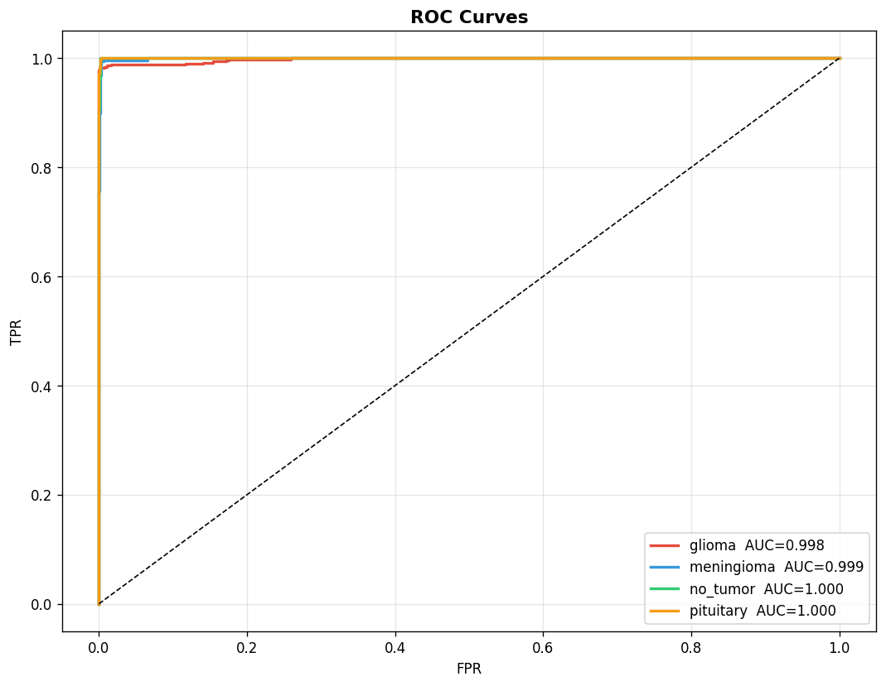
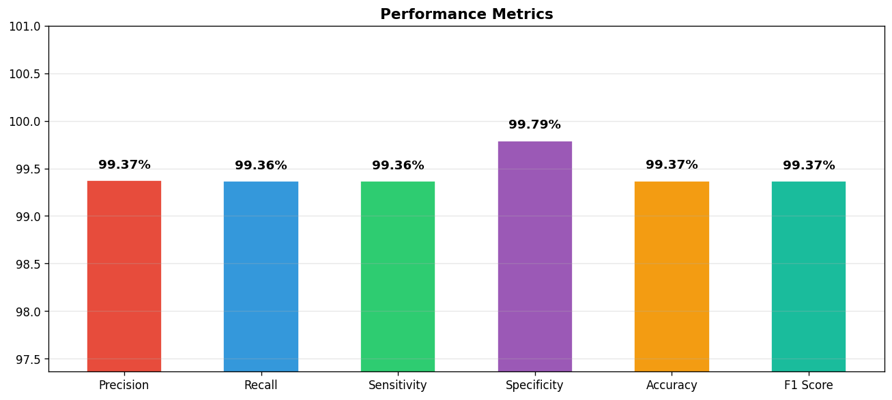
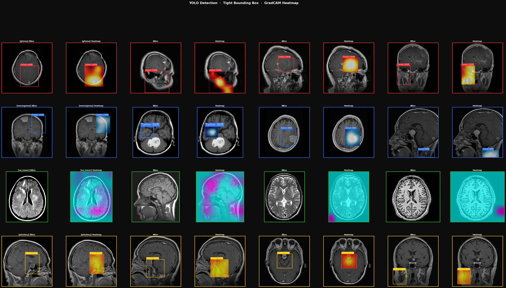
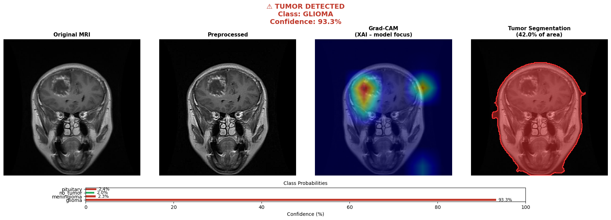
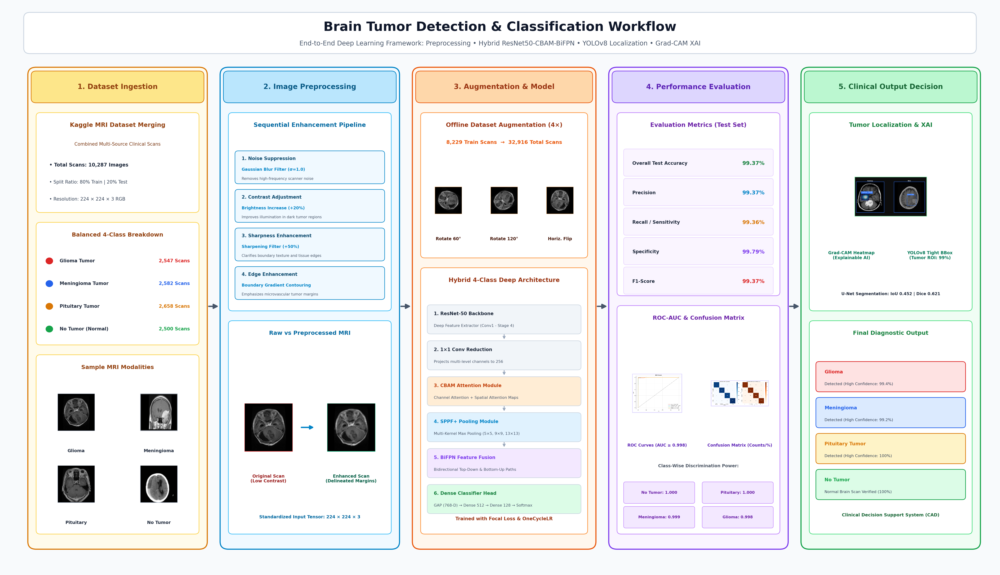

# Brain Tumor Detection & Classification Using Deep Learning

An end-to-end deep learning framework for automated brain tumor detection, classification, and localization from MRI scans. The system classifies brain MRI images into four categories — **Glioma**, **Meningioma**, **Pituitary Tumor**, and **No Tumor** — using a hybrid architecture combining ResNet-50 with attention mechanisms and multi-scale feature fusion.

## Key Features

- **Hybrid Classification Architecture** — ResNet-50 backbone enhanced with CBAM (Channel & Spatial Attention), SPPF+ (Spatial Pyramid Pooling Fast+), and BiFPN (Bidirectional Feature Pyramid Network)
- **Tumor Localization** — YOLOv8 object detector trained on Grad-CAM-guided pseudo-labels to draw tight bounding boxes around tumor regions
- **Tumor Segmentation** — U-Net encoder-decoder with ResNet-34 encoder for pixel-level tumor mask extraction
- **Explainable AI (XAI)** — Grad-CAM heatmaps to visualize which MRI regions drive the model's predictions
- **Offline Data Augmentation** — 4× dataset expansion (8,229 → 32,916 images) using rotation (60°, 120°) and horizontal flip

## Dataset

MRI brain tumor images collected and merged from two publicly available Kaggle datasets:

| Class | Images |
|:------|-------:|
| Glioma | 2,547 |
| Meningioma | 2,582 |
| No Tumor | 2,500 |
| Pituitary | 2,658 |
| **Total** | **10,287** |

## Preprocessing Pipeline

1. **Noise Suppression** — Gaussian blur filter to remove random noise in MRI scans
2. **Brightness Adjustment** — 20% increase to improve illumination of tumor regions
3. **Sharpness Enhancement** — 50% improvement for structural clarity
4. **Edge Enhancement** — Emphasize tumor boundaries and contours
5. **Normalization** — Standard ImageNet normalization for pretrained backbone

## Model Architecture

```
Input MRI (224×224×3)
    → ResNet-50 Backbone (5 stages: 56×56 → 7×7)
    → 1×1 Conv Channel Reduction (→ 256 channels)
    → CBAM Attention (Channel + Spatial) at 3 feature levels
    → SPPF+ Module (5×5, 9×9, 13×13 multi-scale pooling)
    → BiFPN Feature Fusion (3-level bidirectional pyramid)
    → Global Average Pooling (768-D)
    → Dense 512 → Dropout → Dense 128 → Dropout
    → Softmax Output (4 classes)
```

## Training Configuration

| Parameter | Value |
|:----------|:------|
| Framework | PyTorch 2.9 |
| GPU | NVIDIA Tesla P100 (16 GB VRAM) |
| Batch Size | 32 |
| Epochs | 50 (early stopping at epoch 43) |
| Learning Rate | 0.001 |
| Weight Decay | 1e-4 |
| Loss Function | Focal Loss (γ=2) |
| Scheduler | OneCycleLR |
| Mixed Precision | AMP (torch.cuda.amp) |

## Results

### Classification Performance

| Metric | Score |
|:-------|------:|
| Accuracy | 99.37% |
| Precision | 99.37% |
| Recall / Sensitivity | 99.36% |
| Specificity | 99.79% |
| F1-Score | 99.37% |

### ROC-AUC Per Class

| Class | AUC |
|:------|----:|
| Glioma | 0.998 |
| Meningioma | 0.999 |
| No Tumor | 1.000 |
| Pituitary | 1.000 |

### Segmentation Metrics

| Metric | Score |
|:-------|------:|
| IoU | 0.4520 |
| Dice | 0.6214 |

## Sample Outputs

### Preprocessing: Original vs Enhanced


### Model Architecture Diagram


### Training Curves


### Confusion Matrix


### ROC Curves


### Performance Metrics


### YOLO Detection + Grad-CAM Heatmaps


### Inference Demo (Glioma)


### End-to-End Workflow


## Tech Stack

- **Language:** Python 3.12
- **Deep Learning:** PyTorch, Torchvision
- **Object Detection:** Ultralytics YOLOv8
- **Image Processing:** OpenCV, Albumentations, Pillow
- **Data Science:** NumPy, Pandas, Scikit-Learn, Matplotlib
- **Platform:** Kaggle Notebooks (GPU: Tesla P100)
